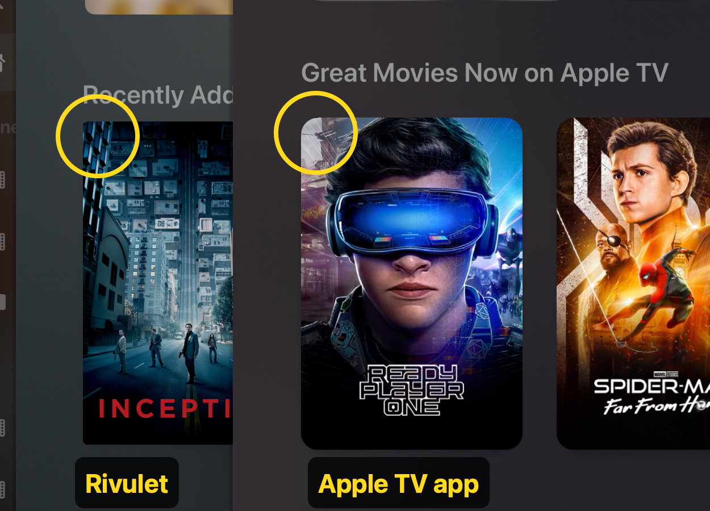

Title: Posters: rounder corners, like the Apple TV app

### Before submitting

- [x] I have searched for existing issues

### Platform

tvOS (Apple TV)

### Describe the feature

Give poster tiles the same rounded corners as the Apple TV app. Rivulet's posters have only slightly rounded corners, while the Apple TV app rounds them clearly more.

### Use case

Rivulet already follows the TV app's look closely in many places. Matching the poster corners would make it feel even more at home next to Apple's own apps.

### Any additional context

Rivulet on the left, the Apple TV app on the right, side by side in the app switcher:

